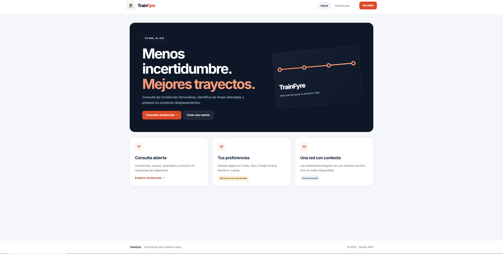
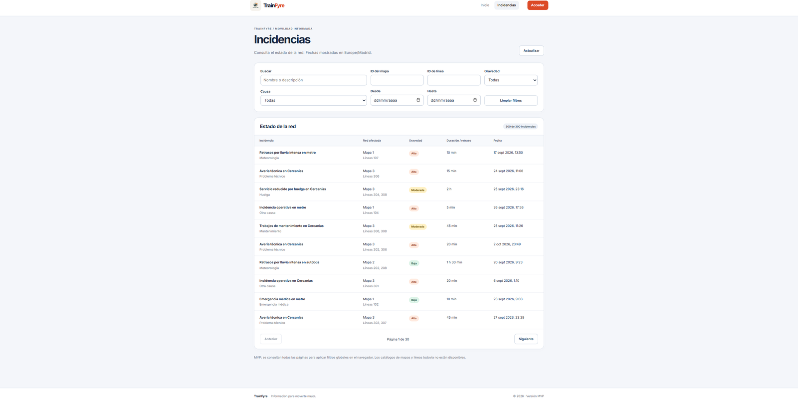
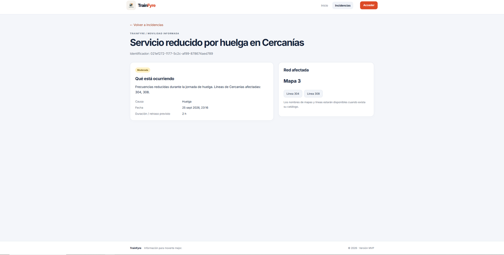
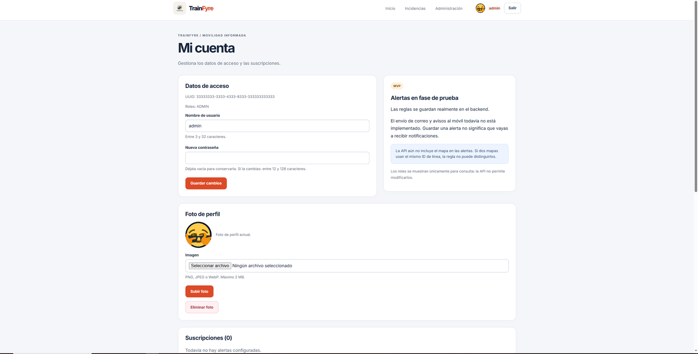

# TrainFyre: A web application for real-time transport alert management

TrainFyre is a web application to consult and manage transport incidents. In version 0.1, anyone can browse and filter the incidences of the network (with their severity, cause, duration and affected lines); registered users can manage their account, upload a profile picture and define alert subscriptions by line, time window and days of the week; and administrators can publish, edit and delete incidences. The application is a SPA built with React, a Spring Boot REST API, PostgreSQL and an S3-compatible storage for the avatars, and it runs with Docker.

> [!IMPORTANT]
> Version 0.1 is the first published version. It contains the basic functionality only, and the development of the application continues to improve and extend it. Alert subscriptions are stored, but **notifications are not sent yet**, and statistics are not available yet.

| | |
| --- | --- |
|  |  |
| Home page | Incidence list with filters |
|  |  |
| Incidence detail | Account and profile picture |

More screenshots, by type of user, in [Features of version 0.1](docs/FEATURES.md).

<!-- TODO(author) PENDING VIDEO: one-minute video of version 0.1 (features by type of user, with voice-over).
     Upload it (YouTube, or drag it into a GitHub issue/PR comment to get a github.com/user-attachments URL) and replace this comment with:
     [Video of version 0.1](PASTE_URL_HERE) -->

<!-- TODO(author) PENDING IMAGES (take them after merging to main and publishing 0.1.0, save them in docs/images/):
     - 23-actions.png      GitHub Actions: successful runs of unit-tests, full-tests and publish  -> add to docs/CI_CD.md
     - 24-github-project.png  GitHub Project Kanban board                                         -> add to docs/PROJECT_TRACKING.md
     - 25-dockerhub.png    DockerHub repository escipion48/trainfyre with the 0.1.0 tag           -> add to docs/CI_CD.md or docs/EXECUTION.md
     - 22-sonar.png        SonarQube Cloud dashboard                                              -> docs/TESTING.md (comment already there)
     Search the repository for "PENDING" to find every placeholder. -->

## Next versions

The following versions are expected to add the functionalities that are still pending in the [detailed functionalities](docs/FUNCTIONALITIES.md): the notification of alerts to subscribed users, statistics and charts of the incidents, and the management of the transport maps and lines. The advanced functionality is still to be defined.

## Documentation index

**Using the application**

- [Features of version 0.1](docs/FEATURES.md): what the application offers, by type of user
- [Detailed functionalities](docs/FUNCTIONALITIES.md): status of every functionality (implemented, partial or pending)
- [Execution](docs/EXECUTION.md): how to run the application with Docker

**Development**

- [Development guide](docs/DEVELOPMENT.md): technologies, tools, process and how to run and edit the code
  - [Architecture](docs/ARCHITECTURE.md): deployment, domain model, server and client
  - [REST API](docs/API.md) ([OpenAPI in HTML](https://raw.githack.com/codeurjc-students/2026-TrainFyre/main/docs/api/api-docs.html), [Postman collection](docs/api/TrainFyre.postman_collection.json))
  - [Quality control](docs/TESTING.md): tests, coverage and static analysis
  - [CI/CD and releases](docs/CI_CD.md)
- [Changelog](CHANGELOG.md)
- [AI usage log](docs/AI_USAGE.md)

**Start of the project (Phase 1)**

- [Objectives](docs/OBJECTIVES.md)
- [Methodology](docs/METHODOLOGY.md)
- [Initial functionalities](docs/INITIAL_FUNCTIONALITIES.md)
- [Analysis](docs/ANALYSIS.md): screens, entities, permissions and complementary technology

**Follow-up and authors**

- [Project tracking](docs/PROJECT_TRACKING.md)
- [Authors](docs/AUTHORS.md)

## Quick start

To run the published version or the development version with sample data, follow [Execution](docs/EXECUTION.md). The development version includes the accounts `admin`, `dev_alice` and `dev_bob`, described there.

## Follow-up

- GitHub Project: [TrainFyre GitHub Project](https://github.com/orgs/codeurjc-students/projects/52)
- Blog / news: not defined

## Authors

This application is being developed as part of the Bachelor's Thesis of Pablo Sainz López, student of the Computer Engineering and Computer Systems Engineering degree at ETSII, URJC, under the supervision of Natalia Madrueño Sierro.

## Use of AI tools

The AI tools used in the phases completed or in progress are summarized here.

| Phase | Tool | Use |
| --- | --- | --- |
| 1. Definition of functionalities and screens | OpenAI ChatGPT | Review and improvement of the documentation: objectives, methodology and analysis, including the domain analysis |
| 1. Definition of functionalities and screens | Google Gemini | Research of similar applications and help with the Markdown format |
| 2. Repository, testing and CI | GitHub Copilot | Audit of the repository against the phase requirements and alignment of the documentation with the code |
| 3. Version 0.1 | JetBrains Junie, GitHub Copilot and a local Qwen 3.6 model | TDD pair programming from JetBrains Air: the agent writes the failing test, the student implements the code and both refactor |
| 3. Version 0.1 | Claude | Refactoring of the frontend (chat) and creation and update of the documentation |

The file [docs/AI_USAGE.md](docs/AI_USAGE.md) has detailed information about each use.
