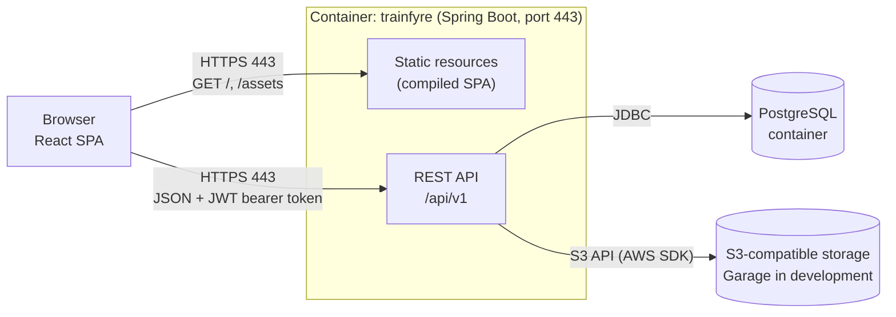
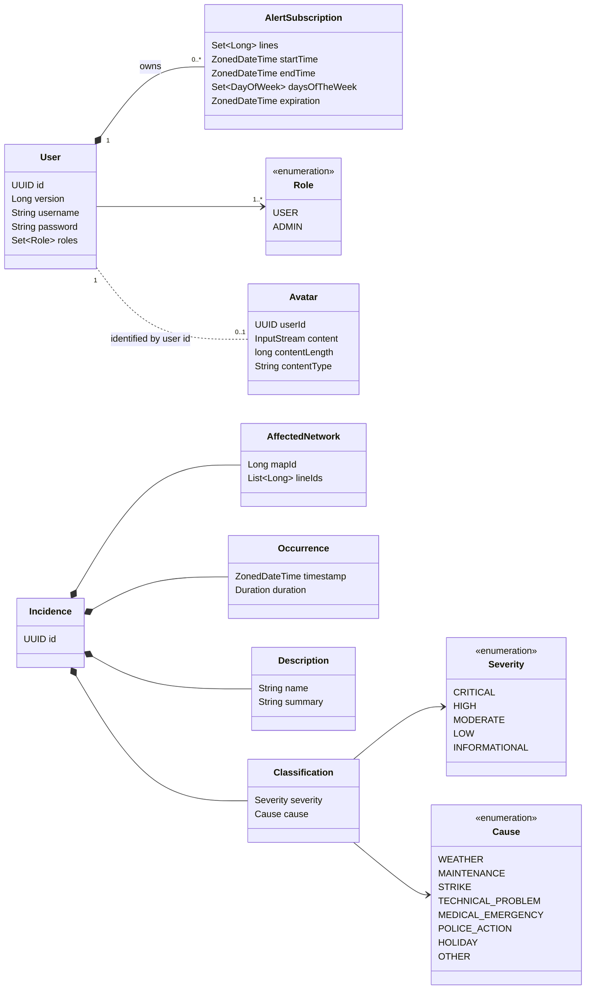
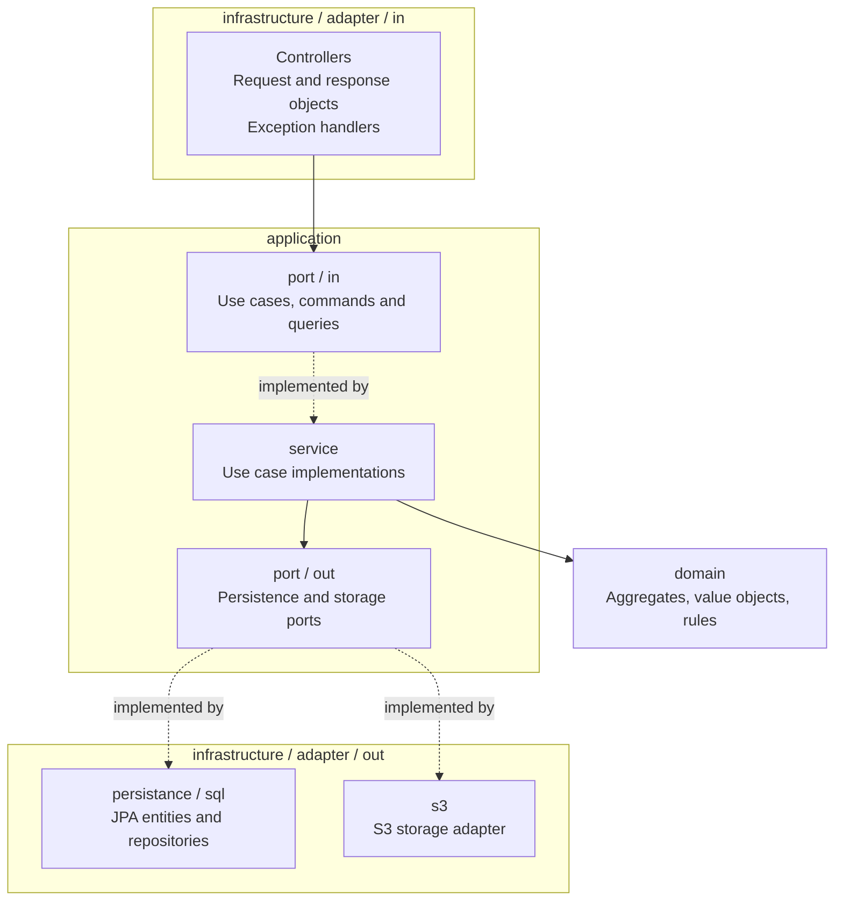
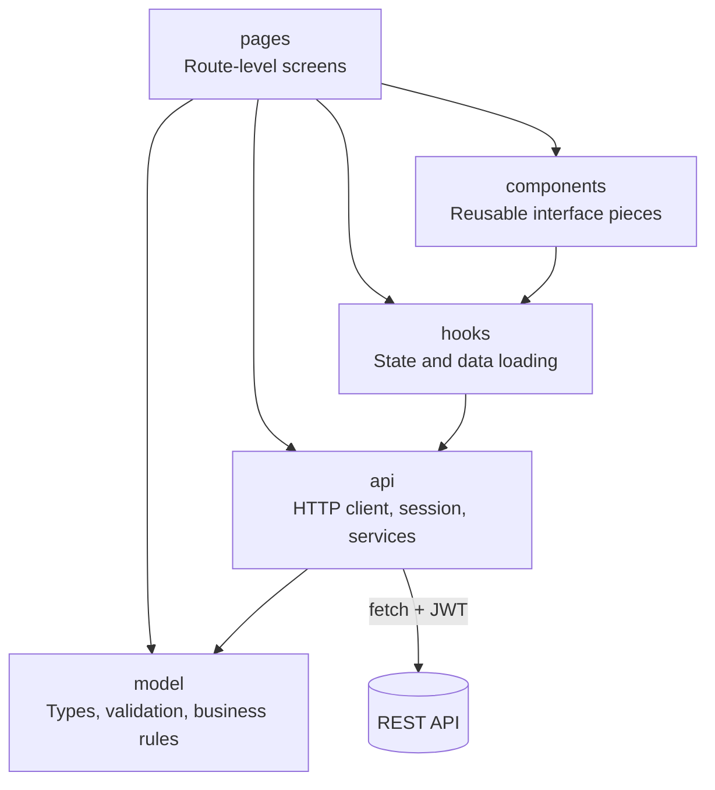

# Architecture

TrainFyre is a web application with a **SPA architecture**: a single-page application written in React that runs in the browser and communicates with a REST API served by a Spring Boot backend, which stores its data in PostgreSQL and the avatars in an S3-compatible object storage service.

## Deployment architecture

In the Docker image the React application is compiled and served as static resources by the Spring Boot backend, so the browser talks to a single HTTPS endpoint.

| Process | Technology | Protocol |
| --- | --- | --- |
| Client | React SPA running in the browser | HTTPS towards the backend |
| Server | Spring Boot (Java 27), also serves the compiled SPA | HTTPS on port 443 |
| Database | PostgreSQL 18 | JDBC (PostgreSQL protocol), only reachable inside the Compose network |
| Object storage | Garage (development) or any S3-compatible service | S3 API over HTTP(S) |

During frontend development the SPA is served by the Vite development server on `http://localhost:5173` and calls the backend on `https://localhost/api/v1`; the backend allows that origin through CORS.

See [Execution](EXECUTION.md) and [CI/CD and releases](CI_CD.md) for how the pieces are started and published.

## REST API

The API is documented with OpenAPI. The specification is stored in [`docs/api/api-docs.yaml`](api/api-docs.yaml) and rendered as HTML:

- [REST API documentation (HTML)](https://raw.githack.com/codeurjc-students/2026-TrainFyre/main/docs/api/api-docs.html)
- [Endpoint reference](API.md)

## Domain model

The persistent entities and value objects of the application are shown below. Maps and lines do not exist as entities: an incidence only references them by numeric identifier.

| Element | Stored in | Notes |
| --- | --- | --- |
| `User` | Tables `users` and `user_roles` | Aggregate root. The username is unique. The password is stored as an Argon2id hash. |
| `AlertSubscription` | Tables `user_alert_subscriptions`, `user_alert_subscription_lines` and `user_alert_subscription_days` | Value object owned by the user. |
| `Incidence` | Table `incidence` | Aggregate root. The lines are stored as a PostgreSQL array of `bigint`. An `INFORMATIONAL` incidence must have a zero duration. |
| `Avatar` (`Image` in the code) | Object storage, one object per user whose key is the user UUID | It is not stored in the database. |

## Server architecture

The backend is a modular monolith organized with **hexagonal architecture** (ports and adapters) and domain-driven design, using jMolecules annotations and Spring Modulith to verify the module boundaries. Each functional module has the same layers.

| Layer | Responsibility |
| --- | --- |
| Controllers (`adapter/in/web`) | Receive HTTP requests, validate the input of the user endpoints (Bean Validation), translate it to commands and queries, call a use case and build the response. They never access repositories directly. |
| Use cases (`application/port/in`) | Interfaces that define what the application can do, together with the command and query objects. Some commands carry the ownership check of the operation (for example the avatar commands). |
| Services (`application/service`) | Implement the use cases and orchestrate domain objects and output ports. The user services apply `UserAccessPolicy` before changing an account. |
| Output ports (`application/port/out`) | Interfaces required by the application: `UserPort`, `IncidencePort` and `ImagePort`. |
| Domain (`domain`) | Aggregates and value objects with their invariants. It does not depend on Spring or on the persistence framework; it only uses jMolecules annotations and Lombok. |
| Output adapters (`adapter/out`) | Implement the ports: JPA repositories for PostgreSQL (`UserJPARepository`, `IncidenceJPARepository`) and `S3StorageAdapter` for the object storage. |

The code is divided into the following modules:

| Module | Contents |
| --- | --- |
| `users` | Registration, login, user management and alert subscriptions. REST controllers `UserController` and `AuthController`. |
| `statistics` | Incidences: create, list, get, update and delete. REST controller `IncidenceController`. The list is read with a slice query and the total number of elements comes from `IncidenceCountCache`. |
| `images` | User avatars: upload, find and delete. REST controller `ImageController` and S3 adapter. |
| `security` | Spring Security configuration: stateless JWT resource server, issuance of RS256 tokens, Argon2 password encoder, CORS and the roles `USER` and `ADMIN`. It exposes its domain types to other modules through a named interface. |
| `common` | Shared types (`Pageable`, `PagedResponse`, port interfaces) and the `SpaController`, which forwards non-API routes to `index.html`. |

`ArchitectureTest` runs `ApplicationModules.verify()` from Spring Modulith, so a dependency that breaks the module boundaries makes the build fail.

### Security

- Authentication is stateless: `POST /api/v1/auth/login` returns a JWT signed with RS256 that expires after 15 minutes and carries the user identifier and roles. The client sends it in the `Authorization: Bearer` header.
- Passwords are hashed with Argon2id.
- Route rules (`SecurityConfiguration`): static resources, `POST /api/v1/auth/login`, `POST /api/v1/users` and `GET /api/v1/incidence` are public; the other `/api/v1/incidence/**` operations require the `ADMIN` role; every other `/api/**` route requires authentication.
- Ownership rules are applied in the application layer: a user account can be managed only by its owner, and an avatar by its owner or by an administrator.
- The application is served by HTTPS with a PKCS12 keystore.

## Client architecture

The frontend is a React 19 application written in TypeScript. It does not use a routing or HTTP library: routes are resolved from the URL hash (`#/incidencias`) and requests are made with `fetch`.

| Layer | Folder | Responsibility |
| --- | --- | --- |
| Pages | `src/pages` | One component per screen (`Home`, `Access`, `AdminUsers`, incidence list, detail and editor, account). `Routes.tsx` maps each hash route to a page. |
| Components | `src/components` | Reusable pieces: forms, fields, actions, notices, `Avatar`, `SiteHeader`, `SiteFooter`, `ErrorBoundary` and `Require`, which hides screens that need a session or the administrator role (the backend always enforces the real authorization). |
| Hooks | `src/hooks` | `useAuth`, `useResource` (asynchronous loading with cancellation), `useGuardedTask` (prevents duplicate submissions), `useAvatar` and `useHashPath`. |
| API services | `src/api` | `http.ts` sends requests, attaches the token and maps errors; `client.ts` exposes one function per operation of the REST API and downloads all the pages of incidences; `session.ts` keeps the session in `sessionStorage`; `auth.ts` signs in and validates the profile. |
| Model | `src/model` | Types, labels, validation, date and duration helpers, and the rules to filter incidences and build subscription and incidence payloads. |

All the pages that list incidences load every page from the API and apply the filters and the pagination of 10 rows in the browser.
