# Features of version 0.1

This document describes what TrainFyre version 0.1 offers, organized by type of user. The user interface is written in Spanish and is navigated with hash routes (for example `#/incidencias`).

The roles are:

- **Visitor**: a person who has not signed in.
- **Registered user**: a person with an account and the `USER` role.
- **Administrator**: a person with the `ADMIN` role.

## Visitor

### Home page

The home page (`#/`) introduces the application and links to the incidence list and to the registration form (or to the account page when the user is already signed in). It also states which parts are not available yet: alert delivery is still being tested and statistics will arrive in a later version.

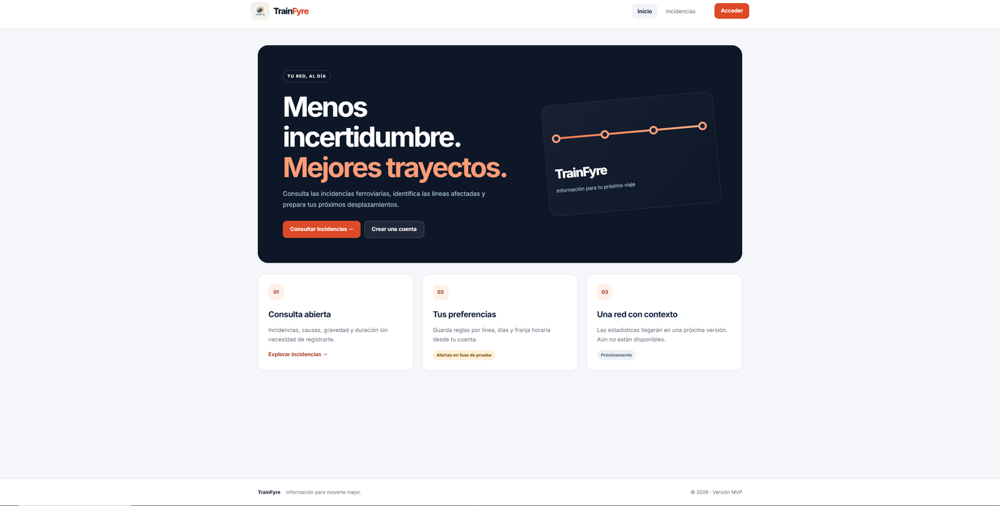

### Browsing incidences

The incidence list (`#/incidencias`) is public and shows, for each incidence, its name, the affected map and lines, its severity, its duration or expected delay, and its date. Dates are shown in the time zone of the browser.

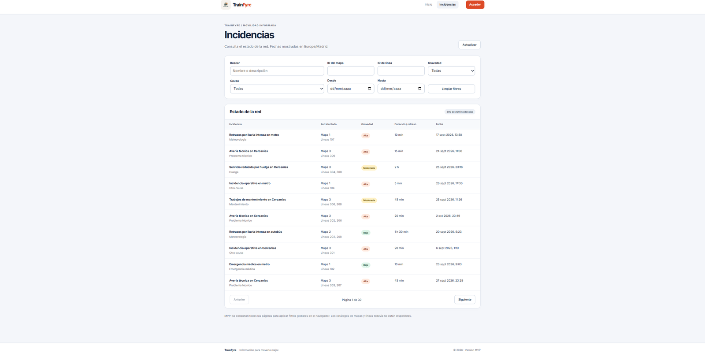

The list can be filtered by:

- free text (name or description),
- map identifier,
- line identifier,
- severity,
- cause,
- a date range (from and to).

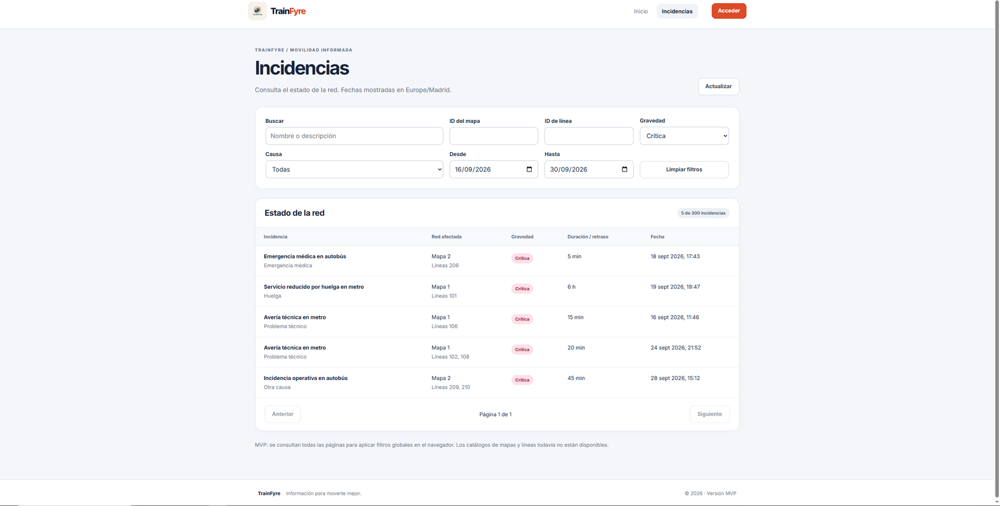

The table shows 10 incidences per page with *Anterior* / *Siguiente* controls. The list can be reloaded with the *Actualizar* button.

Selecting an incidence opens its detail page (`#/incidencias/<id>`), which shows the description, severity, cause, date, duration and the affected map and lines. Maps and lines are shown by identifier because they do not have a catalogue yet.

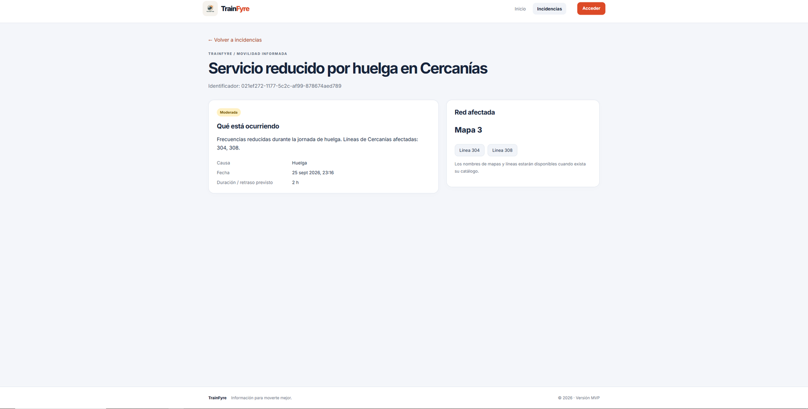

### Registration and sign in

- **Registration** (`#/registro`): the visitor chooses a username (3 to 32 characters: letters, digits, dot, hyphen or underscore) and a password (12 to 128 characters) that must be repeated. After the account is created the user is signed in automatically.

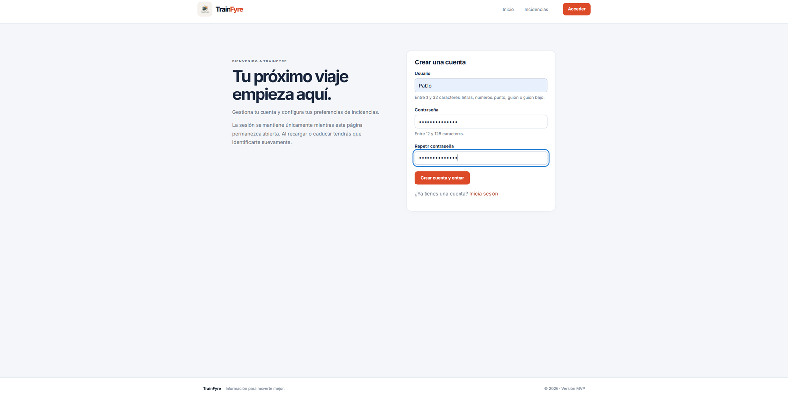
- **Sign in** (`#/acceso`): username and password. The session is kept while the browser tab remains open, survives a page reload, and is checked again when the tab regains focus. Access tokens expire after 15 minutes.

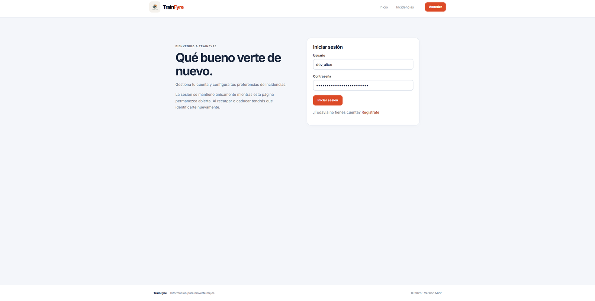

Administration pages cannot be opened without a session; the application shows an access-restricted page instead.

## Registered user

### My account

The account page (`#/cuenta`) lets the user:

- change the username or the password,
- delete the account (after a confirmation),
- see the account identifier and roles.

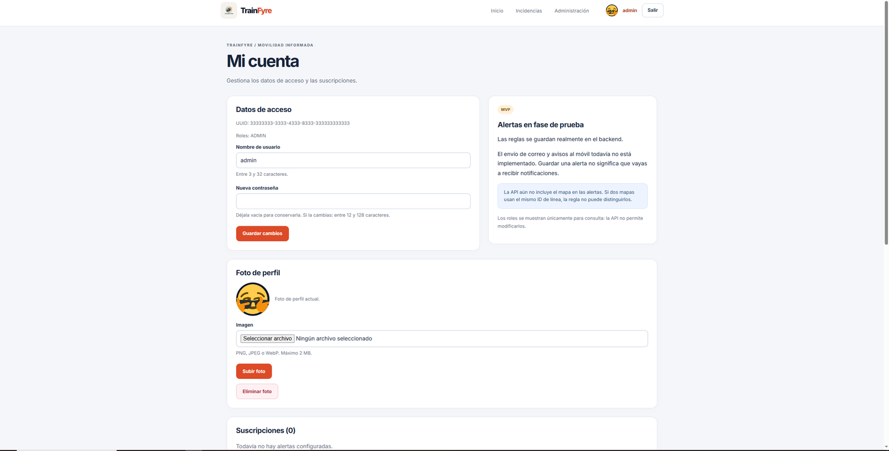

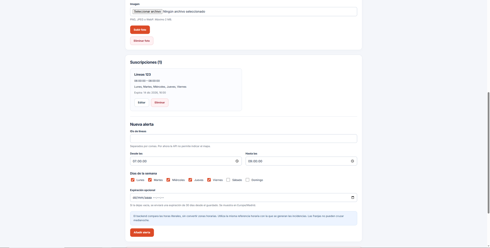

> The screenshots of the account page were taken with the `admin` account. A registered user sees the same page.

<!-- TODO(author) OPTIONAL IMAGE: account page signed in as `dev_alice` (role USER), docs/images/07c-cuenta-usuario.png -->

### Avatar

From the account page the user can upload, replace or delete a profile picture. Accepted formats are PNG, JPEG and WebP, with a maximum size of 2 MB. The avatar is displayed in the site header. Pictures are stored in an S3-compatible object storage service, not in the database.

### Alert subscriptions

From the account page the user can create, edit and delete alert subscriptions. A subscription defines:

- the lines of interest,
- a time window (start and end time),
- the days of the week,
- an optional expiration.

Subscriptions are stored by the backend. **Notifications are not sent yet**: saving a subscription does not mean that the user will receive alerts. The interface states this explicitly. Because the API does not include the map in a subscription, two maps that use the same line identifier cannot be distinguished.

## Administrator

An administrator has all the visitor and registered-user features and, in addition, can:

- **Publish incidences** (`#/incidencias/nueva`): name, description, affected map and lines, date, duration, severity and cause.

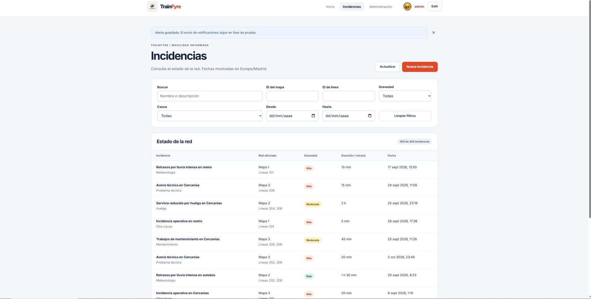

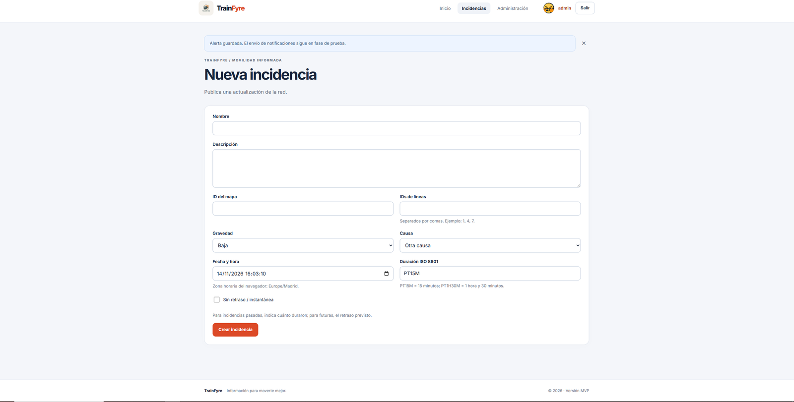
- **Edit incidences** (`#/incidencias/<id>/editar`).
- **Delete incidences**, from the incidence detail page and after a confirmation.

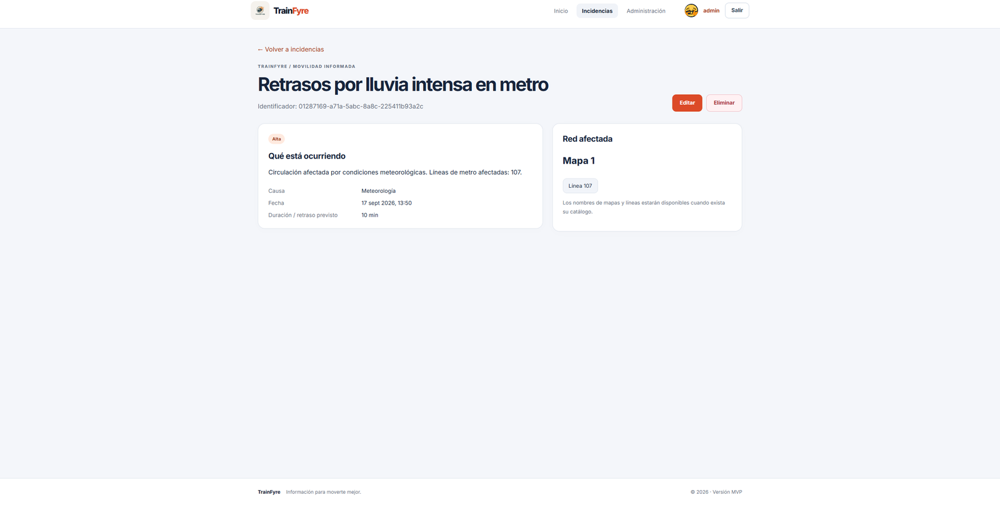
- **Manage avatars of other users** through the REST API, which authorizes the owner of the avatar or an administrator.
- Open the user administration page (`#/admin/usuarios`), where an account can be searched by UUID or created. The backend currently authorizes the management of an account only to its owner, so the administration page cannot modify other users' data; the page says so.

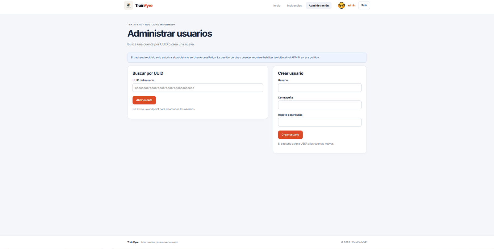

An incidence with `INFORMATIONAL` severity must have zero duration; this rule is enforced by the domain model.

## Error pages

Unknown routes show a *not found* page and unexpected errors in a page show an error page that offers to reload, both with the same visual style as the rest of the application.

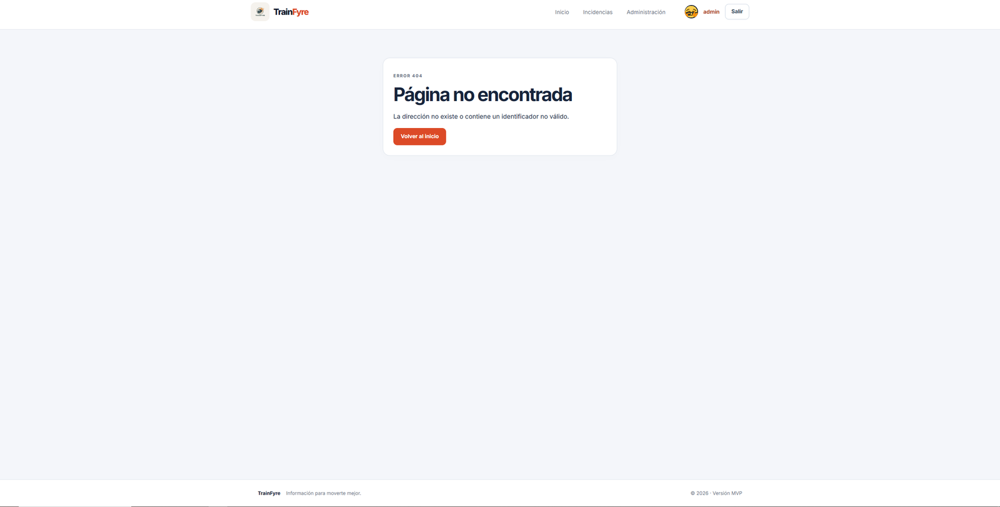

## Mobile layout

The interface adapts to narrow screens: the navigation moves below the logo and the filters are arranged in two columns.

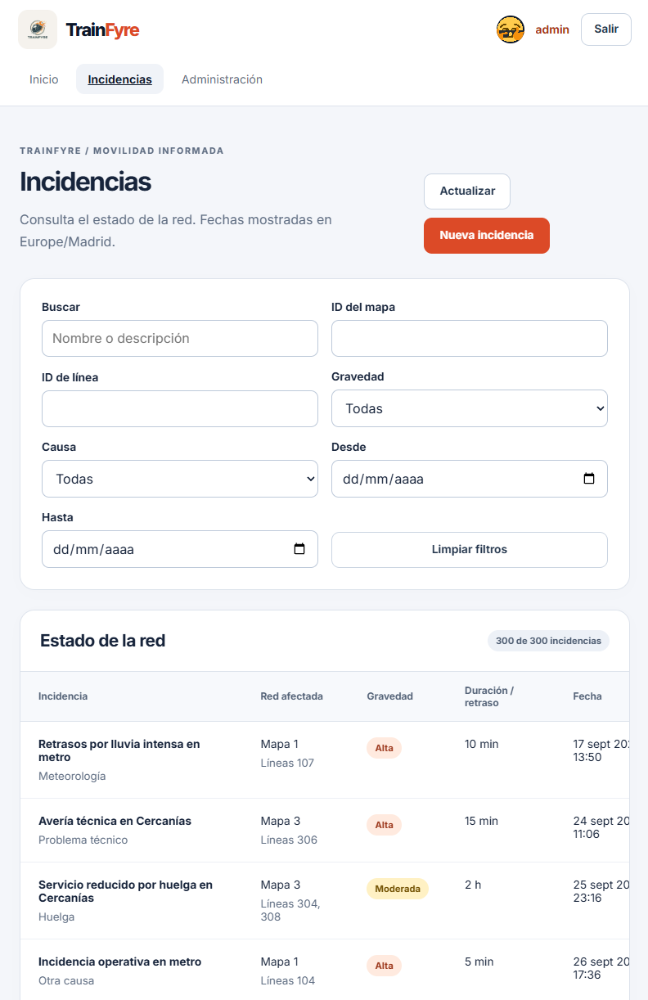

## Features not available in this version

The following features were defined in Phase 1 and are **not** implemented in version 0.1: catalogue of maps and lines, line status dashboard, delivery of notifications (e-mail or other channels), statistics and charts, and system-wide administration of entities other than incidences. See [Detailed functionalities](FUNCTIONALITIES.md) for the status of every functionality.
