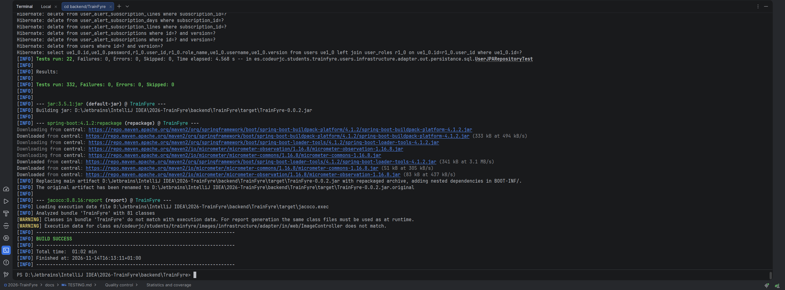
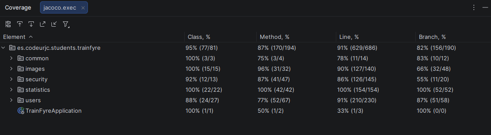

# Quality control

This document describes the automated tests and the static analysis applied to TrainFyre. The workflows that run them are described in [CI/CD and releases](CI_CD.md).

## Test types

### Server (`backend/TrainFyre/src/test`)

| Type | Technology | What it verifies | Examples |
| --- | --- | --- | --- |
| Unit | JUnit 5, Mockito | Domain rules, commands and queries, and use case services with their ports replaced by mocks | `IncidenceTest`, `UserTest`, `AlertSubscriptionTest`, `CreateIncidenceServiceTest`, `UpdateUserServiceTest`, `UploadUserAvatarServiceTest` |
| Controller | Spring MockMvc (`@WebMvcTest`, `@SpringBootTest` with `@MockitoBean`) | HTTP contract of the controllers: status codes, security rules, validation and serialization | `UserControllerIntegrationTest`, `ImageControllerIntegrationTest`, `IncidenceControllerIntegrationTest` |
| Adapter | Mockito (`S3Client`) | The S3 adapter translates the SDK calls and errors | `S3StorageAdapterTest` |
| Integration server - database | `@DataJpaTest` and Testcontainers (PostgreSQL) | Repositories against a real PostgreSQL | `UserJPARepositoryTest`, `IncidencePersistenceIntegrationTest`, `IncidenceJPARepositoryTest` |
| System (E2E) | Rest Assured, `@SpringBootTest` on a random port and Testcontainers (PostgreSQL and MariaDB) | The incidence REST API from the HTTP request to the database | `IncidencePostgreE2ETest`, `IncidenceMariaDbE2ETest` |
| Architecture | Spring Modulith and jMolecules | The module boundaries and the hexagonal rules | `ArchitectureTest` |
| Security | JUnit | JWT issue and verification round trip | `JwtRoundTripTest` |
| Load | Gatling | Behaviour of the API under load (not part of CI). See `src/test/java/.../load/README.md` | `TrainFyreLoadSimulation` |

The server has 332 tests in 65 test classes (`./mvnw verify` on 2026-11-14: 332 run, 0 failures, 0 errors, 0 skipped).

### Client (`frontend/tests`, `frontend/e2e`)

| Type | Technology | What it verifies | Folder |
| --- | --- | --- | --- |
| Unit | Vitest | Model logic: validation, dates, filters, payloads, avatar rules, configuration | `tests/unit` |
| Component | Vitest, Testing Library, jsdom | Pages and components rendered in a virtual DOM with the HTTP services replaced | `tests/components` |
| Integration client - API | Vitest | The HTTP client (`src/api`) against the contract of the REST API: requests, tokens, pagination and error mapping | `tests/integration` |
| System (E2E) | Playwright (Chromium) | Complete user journeys in a real browser against the Vite development server | `e2e` |

The client has 133 unit, component and integration tests (13 files) and 5 end-to-end scenarios.

> **Note on the client tests.** The client - API integration tests and the Playwright scenarios replace the backend: the former mock `fetch` and the latter intercept the requests to the API with `page.route`. They verify the contract that the client expects, but they do not start the real backend. The server verifies its side of that contract with the Rest Assured and MockMvc tests.

## Traceability between functionalities and tests

| Functionality | Server | Client |
| --- | --- | --- |
| Register and sign in | `CreateUserServiceTest`, `LoginServiceTest`, `UserControllerIntegrationTest`, `JwtRoundTripTest` | `tests/components/pages.test.tsx` (registration), `tests/integration/api.test.ts` (login, 401), E2E *el registro inicia sesión y conserva la sesión al recargar* |
| Manage the account (username, password, delete) | `UpdateUserServiceTest`, `DeleteUserServiceTest`, `UserAccessPolicyTest`, `UserJPARepositoryTest` | `tests/components/pages.test.tsx` (account), E2E *un administrador consulta su cuenta...* |
| Alert subscriptions | `AlertSubscriptionTest`, `UserTest`, `UpdateUserServiceTest` | `tests/unit/model-extra.test.ts`, `tests/unit/payload.test.ts`, `tests/components/pages.test.tsx` |
| Avatar | `UploadUserAvatarServiceTest`, `FindUserAvatarServiceTest`, `DeleteUserAvatarServiceTest`, `ImageControllerIntegrationTest`, `S3StorageAdapterTest` | `tests/unit/avatar.test.ts`, `tests/integration/avatar.test.ts`, `tests/components/avatar.test.tsx` |
| List, filter and view incidences | `GetAllIncidencesPaginatedServiceTest`, `GetIncidenceByIdServiceTest`, `IncidenceControllerIntegrationTest`, `IncidencePostgreE2ETest` | `tests/integration/api-branches.test.ts` (pagination), `tests/components/pages.test.tsx` (filters and paging), E2E *un visitante consulta incidencias...* and *muestra y recupera un error de carga...* |
| Publish, edit and delete incidences (admin) | `CreateIncidenceServiceTest`, `UpdateIncidenceServiceTest`, `DeleteIncidenceServiceTest`, `IncidenceTest`, `IncidencePostgreE2ETest`, `IncidenceMariaDbE2ETest` | `tests/components/pages.test.tsx` (editor), E2E *un administrador... publica una incidencia* |
| Access restricted to administrators | `IncidenceControllerIntegrationTest` | `tests/components/pages.test.tsx` (restricted access), E2E *las rutas administrativas no son accesibles sin sesión* |
| Error and not-found pages | - | `tests/components/smoke.test.tsx` |

### Coverage of the quality rule "every functionality has one test of each type"

Version 0.1 does not reach that rule yet for every functionality. The main gaps are:

- The client - API integration and the client E2E tests do not use the real backend (see the note above).
- There are no Rest Assured system tests for the user, authentication and avatar endpoints; they are tested with MockMvc and, for users, with Testcontainers at repository level. The incidence endpoints do have Rest Assured system tests.
- There is no integration test of the avatar storage against a real S3-compatible service; the adapter is tested with a mocked client.

## Running the tests

```bash
# Server: unit tests only (no Docker required)
cd backend/TrainFyre
./mvnw test -Dtest='!*IntegrationTest,!*E2ETest,!TrainFyreApplicationTests' -Dsurefire.failIfNoSpecifiedTests=false

# Server: every test, including Testcontainers (Docker required) and the JaCoCo report
./mvnw verify
```

```bash
cd frontend
npm ci
npm run test:unit          # tests/unit
npm run test:components    # tests/components
npm run test:integration   # tests/integration
npm run test:coverage      # unit + components + integration with coverage
npx playwright install chromium
npm run test:e2e           # Playwright (starts the Vite development server)
```

## Statistics and coverage

| | Tool | Report |
| --- | --- | --- |
| Server | JaCoCo (`prepare-agent` and `report` in the Maven build) | `backend/TrainFyre/target/site/jacoco/` after `./mvnw verify` |
| Client | Vitest with the V8 provider | `frontend/coverage/` after `npm run test:coverage` |

The coverage of both parts is sent to SonarQube Cloud in a single analysis (see below).

Result of the client coverage run (`npm run test:coverage`, 133 tests passing):

| Statements | Branches | Functions | Lines |
| --- | --- | --- | --- |
| 88.68 % | 84.15 % | 91.07 % | 90.37 % |

Result of the server run (`./mvnw verify`, 332 tests passing, build time 1 min 2 s) and its coverage, measured with JaCoCo on 2026-11-14:

| Classes | Methods | Lines | Branches |
| --- | --- | --- | --- |
| 95 % (77/81) | 87 % (170/194) | 91 % (629/686) | 82 % (156/190) |

| Package | Classes | Methods | Lines | Branches |
| --- | --- | --- | --- | --- |
| `common` | 100 % | 75 % | 78 % | 83 % |
| `images` | 100 % | 96 % | 90 % | 66 % |
| `security` | 92 % | 87 % | 86 % | 55 % |
| `statistics` | 100 % | 100 % | 100 % | 100 % |
| `users` | 88 % | 77 % | 91 % | 87 % |





## Static analysis

The project is analysed with SonarQube Cloud (organization `codeurjc-students`, project `codeurjc-students_2026-TrainFyre`). The configuration is in `sonar-project.properties`. The analysis runs in the full-quality workflow of every pull request to `main` and of every push to `main`, and combines the JaCoCo report of the server with the lcov report of the client. Tests, sample data, assets and generated files are excluded.

The client can also be linted with `oxlint` (`npm run lint`, run manually) and is type-checked with TypeScript (`npm run typecheck`, which is also part of `npm run build` and therefore of both workflows).

<!-- TODO(author) PENDING IMAGE: SonarQube Cloud dashboard (quality gate, coverage, duplications, issues).
     Save the screenshot as docs/images/22-sonar.png (take it after merging to main) and replace this comment with:
      -->

### Size of the code

Measured on the `51-alignment-with-project-evaluation-guidelines` branch (physical lines, including comments and blank lines):

| Part | Language | Files | Lines |
| --- | --- | --- | --- |
| Server (`src/main/java`) | Java | 112 | 3,109 |
| Server tests (`src/test/java`) | Java | 65 | 8,073 |
| Client (`src`) | TypeScript / TSX | 53 | 3,260 |
| Client styles (`src`) | CSS | 1 | 768 |
| Client tests (`tests`, `e2e`) | TypeScript / TSX | 15 | 2,439 |
